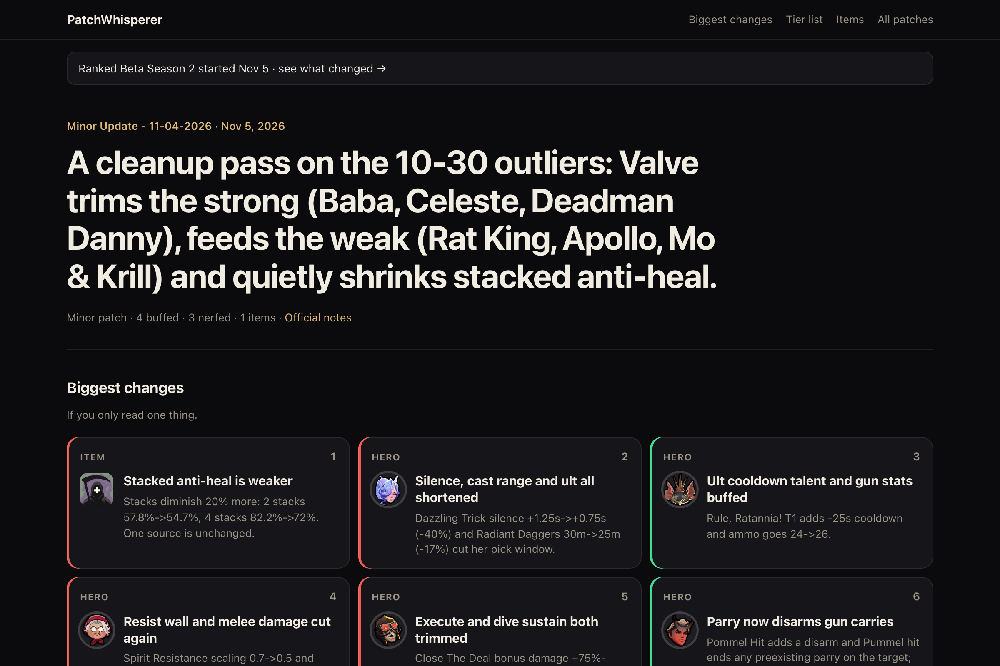
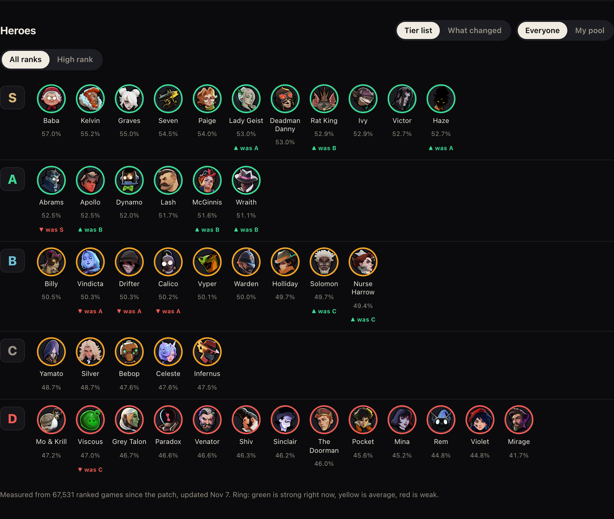
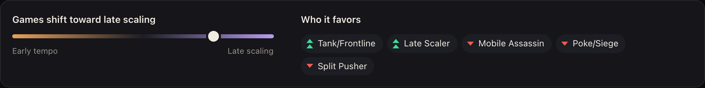
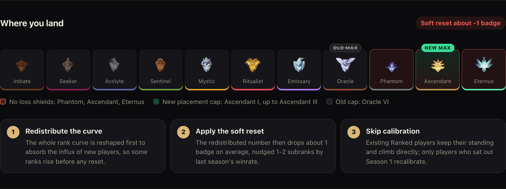

# PatchWhisperer

PatchWhisperer is a public website that analyzes every Deadlock patch. A
watcher on a Mac polls Steam News, runs an LLM pipeline over the notes, measures
hero tiers and matchups from public match data, and pushes the results to git.
GitHub Actions rebuilds the site and deploys it to Cloudflare.

Live site: https://patch-whisperer.plaid-earth.workers.dev

[](https://patch-whisperer.plaid-earth.workers.dev)

## What a patch page shows

`pw site build` turns each analyzed patch in `kb/patches/` into a static page:

- **Biggest changes**: the handful of changes that matter most.
- **Tier list**: hero tiers measured from match data, not model opinion
  (`analysis/tiers.py`). Two bands: All ranks and High rank (Ascendant and
  Eternus games). Post-patch games are compared against games since the previous
  patch, so the last patch's effects are not credited to this one. Until 3,000
  post-patch games exist, the board shows pre-patch data and says so. With no
  match data at all, it falls back to an AI estimate from the notes.
- **Your pool**: a hero picker stored in the browser (localStorage). Highlights
  how your heroes fared without any account or login.
- **Game plan**: a pace gauge (early tempo vs. late scaling) and a "Who it
  favors" list of archetypes.
- **Items**: item changes grouped by category.
- **Map & economy**: system-level changes.





Every hero and item tile opens a detail sheet with the change text, verdict,
and measured stats. All patches are indexed at `/patches/`.

## Ranked season pages

Ranked-season announcements get their own page (`analysis/season.py`, one LLM
extraction guided by `prompts/season_extract.md`): a season progress timeline, a
"Where you land" rank ladder with badge art, "What changed" rule cards rendered
as pips or before/after bars, and a "Who wins, who loses" summary.



## How it stays current

- A launchd agent (`launchd/com.patchwhisperer.watch.plist`, installed by
  `launchd/install.sh`) runs `pw watch` on one Mac. It polls Steam News every
  `POLL_INTERVAL_S` seconds (default 300).
- Each post is classified (`sources/steam_news.py`): `balance`, `major`,
  `hero_release`, `ranked_season`, or `other` (ignored).
- `balance`/`major` posts run the analysis pipeline (`bot/jobs.py`
  `analyze_and_post`), which also refreshes measured matchups
  (`analysis/matchups.py`), then commits `kb/` and pushes. Analysis artifacts
  are committed before the stage-6 KB update, so a KB failure cannot keep a
  patch off the site.
- `ranked_season` posts are extracted into `season.json` and committed.
- `hero_release` posts trigger roster sync: a day-0 evaluation writes a
  provisional KB entry, and a check-in seven days later re-evaluates with real
  usage data.
- `.github/workflows/site.yml` runs on pushes to `master` that touch
  `kb/patches/` or `src/patchwhisperer/site/`, plus every six hours and on
  demand. It runs `pw tiers refresh` (best-effort), `pw site build --out
  site-dist`, and deploys `site-dist` to Cloudflare Workers static assets via
  `wrangler`. On push events it then posts one Discord webhook message per newly
  added page (`pw site notify`).

Required repo secrets: `CLOUDFLARE_API_TOKEN`, `CLOUDFLARE_ACCOUNT_ID` (deploy
is skipped without them), `DISCORD_WEBHOOK_URL` (optional; notification is
skipped without it).

## The LLM pipeline

| Stage | Prompt | What it does |
|---|---|---|
| 0 | `stage0_digest` | Major updates only: turns the JS-rendered update page into patch-note lines |
| 1 | `stage1_systems` | Systems/map changes, tempo direction, effect per archetype |
| 2 | `stage2_items` | Per-item direction and affected heroes |
| 3 | `stage3_heroes` | One entry per hero, in 12-hero batches, plus a second-reader audit pass per batch |
| 4 | `stage4_synthesis` | Patch size, headline, meta thesis, winners/losers |
| 5 | `stage5_pool` | keep/watch/bench verdict per pool hero |
| 6 | `stage6_kb_update` | New `meta.md` + item updates |
| 6h | `stage6_kb_heroes` | Changed-fields-only hero updates in 10-hero batches |

Hotfixes skip stages 1-3 and 5; only the synthesis runs. Stage 6 no longer
writes `tier`, `matchups`, or `matchup_notes`: tiers and matchups are measured
from deadlock-api match data (`pw tiers refresh`, `pw matchups`).

## The knowledge base

`kb/` is the analyst's memory, versioned in git and read before every patch:

- `heroes.yaml`, `items.yaml`: per-entity tier, role, builds, matchups, notes
- `meta.md`: the current meta thesis
- `corrections.md`: reader corrections the analysis must respect
- `sources/`: distilled creator transcripts used to seed the KB
- `patches/<patch_id>/`: every run's prompts, raw model output, parsed
  `patch.json`/`analysis.json` (or `season.json`), and `tiers.json`

## Data sources

- Steam News API (`ISteamNews/GetNewsForApp`, app 1422450): patch posts
- deadlock-api.com: hero/item/rank assets, hero stats, matchup counters
- YouTube transcripts: `pw ingest` + `pw distill` seed the KB from creator takes

## Configuration

All via `.env` (see `.env.example`):

| Variable | Default | Purpose |
|---|---|---|
| `CMDC_API_KEY` | - | LLM provider key |
| `LLM_BASE_URL` | `https://api.commandcode.ai/provider/v1` | OpenAI-compatible endpoint |
| `LLM_MODEL` | `deepseek/deepseek-v4-flash` | Model for all stages |
| `DEFAULT_POOL` | empty | Pool for `pw analyze` when `--pool` isn't given |
| `POLL_INTERVAL_S` | `300` | Steam News poll interval for `pw watch` |
| `HEALTHCHECK_URL` | - | Pinged after each poll iteration |
| `STATE_DB` | `./state.db` | SQLite seen/pool state DB |
| `DISCORD_WEBHOOK_URL` | - | Only needed by `pw site notify` |

## Development

```sh
uv sync                                  # deps (pyproject.toml)
uv run pytest -q                         # test suite (tests/, no network needed)
uv run ruff check .
uv run pw site build --out site-dist     # local site preview -> site-dist/index.html
uv run pw demo                           # replay a recorded pipeline run, offline
```

```
src/patchwhisperer/
  analysis/    pipeline stages, prompts/, tiers, matchups, season extract, renderers
  bot/         poller, job orchestration, sqlite state
  kb/          KB store (yaml/md) + git sync/commit helpers
  parse/       BBCode patch parser, entity index, models
  site/        static site build, page models, templates, notify webhook
  sources/     steam_news, deadlock_api, youtube, update_page
demo/          recorded run for `pw demo`
launchd/       macOS keepalive install script for `pw watch`
tests/         pytest suite with canned LLM fixtures
```

## CLI

```sh
pw demo [--full] [--keep]      # offline replay of a recorded pipeline run
pw fetch [--count N]           # list recent patch posts
pw parse <gid|latest>          # parse a patch into structured changes
pw analyze <gid|latest>        # run the pipeline yourself (needs LLM credentials)
pw season <gid> [--force]      # extract a ranked-season post into kb/patches
pw watch                       # poll Steam News, analyze, commit kb/
pw site build --out site-dist  # build the static site
pw site notify <added-file>    # post Discord links for new pages
pw tiers refresh               # rewrite tiers.json from current match data
pw matchups                    # replace KB matchups with measured ones
pw kb init                     # seed kb/heroes.yaml from live assets
pw ingest <youtube_url>        # fetch a transcript into kb/sources/raw/
pw distill <raw>               # distill a transcript into KB seed claims
pw seed [--patches N]          # build the initial KB from sources + recent patches
pw snapshot                    # top-10 heroes by win rate (last 14 days)
pw enrich [--all|--hero H]     # refresh builds/matchups from usage + counter data
pw roster sync [--dry-run]     # evaluate new heroes + due check-ins
pw roster checkin <hero>       # run the 7-day check-in for one hero
```

PatchWhisperer started as a Discord bot; that code lives on the `discord-bot`
branch. The live product is the website.
